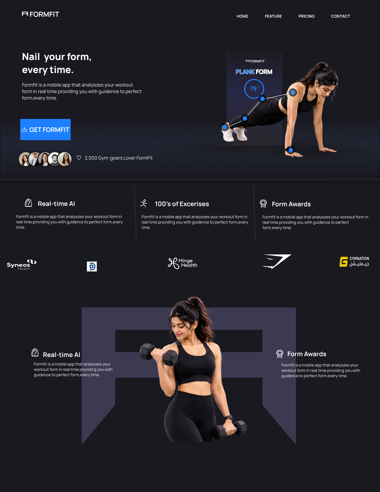

# FORMFIT – Fitness Website UI/UX Design

## About the Project
FORMFIT is a fitness website design focused on providing a clean, modern, and user-friendly experience for people interested in fitness and workout activities.

## Project Details
- Project Type: Website UI/UX Design
- Tools Used: Figma, Framer
- Design Focus: Modern UI, User Experience, Responsive Layout
- Role: UI/UX Designer

## Project Features
- Modern fitness-focused interface
- Clean and simple layouts
- User-friendly navigation
- Fitness-related visual elements

## Live Project
View Live FORMFIT Website – https://formfit-green-motion.lovable.app

## Portfolio
View my porfolio-https://swethadevara.framer.website/
## Project Screenshots

### FORMFIT Logo

### Homepage Design

### Login Page

